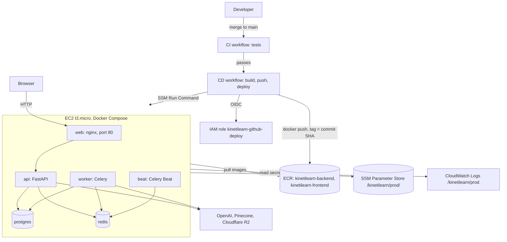

# Deployment

KinetiLearn runs on one EC2 instance with Docker Compose. A merge to `main`
runs CI; when CI passes, GitHub Actions builds both images, pushes them to
Amazon ECR, and deploys them through SSM Run Command. No SSH keys, no
long-lived AWS keys, and no secrets in git or in the images.

This is a runbook for one person operating a demo, not a production platform.
Read [Honest limits](#honest-limits) before relying on it.

## Architecture



nginx serves the React build and proxies `/api/` and `/health` to the API, so
the browser sees one origin and CORS stays unchanged. Only port 80 is open;
Postgres and Redis have no published ports.

## Files

| File | Role |
|---|---|
| `.github/workflows/ci.yml` | Backend and frontend tests. Skips pushes that change only `**.md` or `docs/**` |
| `.github/workflows/cd.yml` | Builds, pushes, and deploys after CI passes; manual run with `image_tag` rolls back |
| `deploy/deploy.sh` | Runs on the instance as root: writes `.env`, migrates, starts containers, checks `/health`, rolls back on failure |
| `docker-compose.prod.yml` | Production stack: `web`, `api`, `worker`, `beat`, `postgres`, `redis` |
| `.env.prod.example` | Shape of the instance's `.env`, with fake values |
| `frontend/Dockerfile`, `frontend/nginx.conf` | Frontend image: Vite build served by nginx |
| `backend/scripts/create_admin.py` | Creates the first admin; prompts for the password |

## One-time AWS setup

Region `ap-southeast-1`. Everything below was created by hand in the AWS
console, in this order. Replace `<ACCOUNT_ID>` and `<INSTANCE_ID>` with your
own values.

### 0. Billing first

Create a monthly cost budget with email alerts before any other resource.

### 1. Services outside AWS

Production data stays apart from dev:

- **Pinecone:** index `kinetilearn-prod`, dimension 1536, metric cosine,
  serverless on AWS `us-east-1`, plus its own API key. The code has no
  namespace support, so a second index is the separation.
- **Cloudflare R2:** bucket `kinetilearn-prod`, public access off, and an
  account API token with Object Read & Write on that bucket only.
- **OpenAI:** project `kinetilearn-prod` with an enforced monthly spend limit,
  an allowed-models list of `gpt-6-sol`, `gpt-6-luna` and
  `text-embedding-3-small`, and a service-account key with no expiry.

### 2. ECR, logs, network

- ECR repositories `kinetilearn-backend` and `kinetilearn-frontend`, each with
  a lifecycle rule: image count more than 5, expire.
- CloudWatch log group `/kinetilearn/prod`, 7-day retention.
- Security group `kinetilearn-web`: inbound TCP 80 from anywhere, nothing
  else. Keep the default outbound rule; the instance needs it to reach SSM,
  ECR and CloudWatch.

### 3. GitHub OIDC provider

IAM, Identity providers: OpenID Connect, URL
`https://token.actions.githubusercontent.com`, audience `sts.amazonaws.com`.

### 4. Role `kinetilearn-github-deploy`

Web identity role for GitHub Actions. Trust policy, limited to one repo and
one branch:

```json
{
  "Version": "2012-10-17",
  "Statement": [
    {
      "Effect": "Allow",
      "Principal": {
        "Federated": "arn:aws:iam::<ACCOUNT_ID>:oidc-provider/token.actions.githubusercontent.com"
      },
      "Action": "sts:AssumeRoleWithWebIdentity",
      "Condition": {
        "StringEquals": {
          "token.actions.githubusercontent.com:aud": "sts.amazonaws.com",
          "token.actions.githubusercontent.com:sub": "repo:alngxx/KinetiLearn-AI:ref:refs/heads/main"
        }
      }
    }
  ]
}
```

Inline policy `ecr-push`:

```json
{
  "Version": "2012-10-17",
  "Statement": [
    {
      "Effect": "Allow",
      "Action": "ecr:GetAuthorizationToken",
      "Resource": "*"
    },
    {
      "Effect": "Allow",
      "Action": [
        "ecr:BatchCheckLayerAvailability",
        "ecr:InitiateLayerUpload",
        "ecr:UploadLayerPart",
        "ecr:CompleteLayerUpload",
        "ecr:PutImage"
      ],
      "Resource": [
        "arn:aws:ecr:ap-southeast-1:<ACCOUNT_ID>:repository/kinetilearn-backend",
        "arn:aws:ecr:ap-southeast-1:<ACCOUNT_ID>:repository/kinetilearn-frontend"
      ]
    }
  ]
}
```

Inline policy `ssm-run-deploy` (add it after step 7, once the instance ID
exists):

```json
{
  "Version": "2012-10-17",
  "Statement": [
    {
      "Effect": "Allow",
      "Action": "ssm:SendCommand",
      "Resource": [
        "arn:aws:ec2:ap-southeast-1:<ACCOUNT_ID>:instance/<INSTANCE_ID>",
        "arn:aws:ssm:ap-southeast-1::document/AWS-RunShellScript"
      ]
    },
    {
      "Effect": "Allow",
      "Action": "ssm:GetCommandInvocation",
      "Resource": "*"
    }
  ]
}
```

### 5. Role `kinetilearn-ec2`

AWS service role for EC2; the console also creates an instance profile with
the same name. Attach `AmazonSSMManagedInstanceCore` and
`AmazonEC2ContainerRegistryReadOnly`, plus inline policy
`kinetilearn-runtime`:

```json
{
  "Version": "2012-10-17",
  "Statement": [
    {
      "Effect": "Allow",
      "Action": ["ssm:GetParameter", "ssm:GetParameters", "ssm:GetParametersByPath"],
      "Resource": [
        "arn:aws:ssm:ap-southeast-1:<ACCOUNT_ID>:parameter/kinetilearn/prod",
        "arn:aws:ssm:ap-southeast-1:<ACCOUNT_ID>:parameter/kinetilearn/prod/*"
      ]
    },
    {
      "Effect": "Allow",
      "Action": ["logs:CreateLogStream", "logs:PutLogEvents"],
      "Resource": "arn:aws:logs:ap-southeast-1:<ACCOUNT_ID>:log-group:/kinetilearn/prod:*"
    }
  ]
}
```

No KMS statement is needed: SecureString parameters use the default
`aws/ssm` key. Check the role afterwards: it must list three policies.

### 6. SSM parameters

Standard tier, under `/kinetilearn/prod/`. The name after the last `/`
becomes the environment variable name, so it must match
`backend/app/core/config.py` exactly.

| Name | Type |
|---|---|
| `OPENAI_API_KEY`, `PINECONE_API_KEY`, `R2_ACCESS_KEY`, `R2_SECRET_KEY` | SecureString |
| `JWT_SECRET`, `POSTGRES_PASSWORD` | SecureString, from `openssl rand -hex 32` |
| `PINECONE_INDEX`, `VECTOR_STORE_BACKEND`, `R2_BUCKET_NAME`, `R2_ENDPOINT_URL` | String |

Type secret values into the console yourself. Use hex for `POSTGRES_PASSWORD`
so `DATABASE_URL` never breaks, and never change it after the first deploy:
Postgres reads it only when it creates the volume.

### 7. EC2 instance and Elastic IP

- Amazon Linux 2023, 64-bit x86 (the images are built on x86 runners),
  `t3.micro`, 30 GiB gp3, no key pair.
- Security group `kinetilearn-web`, instance profile `kinetilearn-ec2`.
- Metadata: IMDSv2 required, response hop limit 1, so containers cannot read
  the instance role's credentials.
- User data:

```bash
#!/bin/bash
set -euxo pipefail

dnf install -y docker
systemctl enable --now docker

mkdir -p /usr/local/lib/docker/cli-plugins
curl -fsSL https://github.com/docker/compose/releases/download/v2.29.7/docker-compose-linux-x86_64 \
  -o /usr/local/lib/docker/cli-plugins/docker-compose
chmod +x /usr/local/lib/docker/cli-plugins/docker-compose

dd if=/dev/zero of=/swapfile bs=1M count=2048
chmod 600 /swapfile
mkswap /swapfile
swapon /swapfile
echo '/swapfile none swap sw 0 0' >> /etc/fstab

mkdir -p /opt/kinetilearn
```

Allocate an Elastic IP and associate it with the instance. The frontend bakes
the API address into its JavaScript at build time, so the address must not
change. Confirm the instance shows **Online** in Systems Manager, Fleet
Manager, before the first deploy.

### 8. Alerts

- SNS topic `kinetilearn-alerts` with a confirmed email subscription.
- CloudWatch alarm `kinetilearn-high-cpu`: EC2 `CPUUtilization`, average over
  5 minutes, greater than 80 for 2 of 2 datapoints, missing data treated as
  breaching, notifying `kinetilearn-alerts`.

### 9. GitHub repository variables

Settings, Secrets and variables, Actions, Variables. None of these are
secrets; the IAM trust policy is what limits access.

| Variable | Value |
|---|---|
| `AWS_REGION` | `ap-southeast-1` |
| `AWS_ACCOUNT_ID` | `<ACCOUNT_ID>` |
| `DEPLOY_ROLE_ARN` | `<ROLE_ARN>` of `kinetilearn-github-deploy` |
| `EC2_INSTANCE_ID` | `<INSTANCE_ID>` |
| `PUBLIC_URL` | `http://<ELASTIC_IP>`, no trailing slash |

## How a deploy works

1. A push to `main` runs CI (`ci.yml`). A push that changes only `**.md` or
   `docs/**` skips CI and therefore skips the deploy. Pull requests always
   run CI.
2. When CI succeeds on a push, `cd.yml` starts through `workflow_run`. The
   workflow file must already be on `main` for this trigger to fire.
3. Job `build` checks out the exact commit CI tested
   (`github.event.workflow_run.head_sha`), assumes `kinetilearn-github-deploy`
   through OIDC, builds both images, tags them with the full commit SHA (never
   `latest`), and pushes them to ECR. The frontend build receives
   `VITE_API_BASE_URL` from the `PUBLIC_URL` variable.
4. Job `deploy` base64-encodes `deploy/deploy.sh` and
   `docker-compose.prod.yml` into one `AWS-RunShellScript` command and sends
   it to the instance. Run Command history and CloudTrail keep the command
   text, so it carries no secrets. The job polls the result for up to 15
   minutes and prints the script output in the job log.
5. On the instance, `deploy.sh`:
   - pulls both images first, so a missing image leaves the running release
     untouched;
   - keeps the previous compose file, then writes `/opt/kinetilearn/.env`
     from Parameter Store with mode 600, printing key names only;
   - runs `alembic upgrade head`, then `docker compose up -d`;
   - polls `http://localhost/health` for up to 3 minutes;
   - on failure, prints container status and recent logs, restarts the
     previous tag with its compose file, and exits non-zero;
   - on success, records the tag in `/opt/kinetilearn/current_tag` and prunes
     unused images.

One deploy runs at a time (`concurrency: deploy`). Containers restart in
place, so requests can fail while the API comes back up.

## Rolling back

1. Find a tag to roll back to: ECR, `kinetilearn-backend`, Image tags. The
   same tag must also exist in `kinetilearn-frontend`.
2. Actions, **CD**, **Run workflow**, branch `main`, and paste the full
   40-character SHA into `image_tag`.
3. Job `build` is skipped. Job `deploy` checks out that commit, so the compose
   file matches the images, and deploys the tag.

Limits:

- The lifecycle rule keeps the last 5 images per repository. An older SHA
  still exists in git, but its image does not; that rollback fails at
  `docker pull` and the running release stays up.
- Rollback does not undo migrations. An older image runs against the newer
  schema. Write migrations that the previous release can live with: add
  nullable columns first, and drop columns a release later.

To return to the latest release, run the workflow again with the newest SHA.

## Logs

| Where | What |
|---|---|
| GitHub Actions, run **CD**, job `deploy`, step **Wait for deploy** | Full `deploy.sh` output for that deploy |
| Systems Manager, Run Command, Command history | The same output; the console panel shows at most 24,000 characters |
| CloudWatch Logs, `/kinetilearn/prod` | Container output, one stream per container (`{{.Name}}`, for example `kinetilearn-api-1`) - not verified yet |
| Session Manager shell on the instance | `sudo docker ps`, then `sudo docker compose -p kinetilearn -f /opt/kinetilearn/docker-compose.prod.yml logs --tail 100 api` (reads Docker's local copy of `awslogs` output - not verified yet) |

Open a shell with EC2, Connect, **SSM Session Manager**. The EC2 Instance
Connect option needs port 22, which stays closed.

## First-deploy checklist

Run this once on a fresh instance and database:

1. `http://<ELASTIC_IP>/health` returns `{"status":"ok","database":"ok"}`.
2. `http://<ELASTIC_IP>` shows the login page.
3. Create the first admin from a Session Manager shell. The password prompt
   does not echo and needs at least 12 characters:
   ```bash
   sudo docker exec -it kinetilearn-api-1 python -m scripts.create_admin
   ```
4. Load config data (the only seed allowed here, see below):
   ```bash
   sudo docker exec kinetilearn-api-1 python -m scripts.seed_config
   ```
5. Sign in as the admin and create a class. A document upload needs at least
   one class.
6. Upload a real PDF of about 15 MB and wait until Processing shows Ready.
7. Create a learner in the admin portal with a password you choose, and add
   them to the class.
8. Sign in as the learner, open the class chat, ask about the PDF, and confirm
   the answer cites sources and streams in piece by piece.
9. Check that CloudWatch `/kinetilearn/prod` has a stream per container.

## Troubleshooting `awslogs`

The `awslogs` log driver was not tested locally. If containers fail to start
on the instance, with an error that mentions logging or `awslogs`, check in
this order:

1. **Log group:** `/kinetilearn/prod` exists, spelled exactly so, in
   `ap-southeast-1`. The driver writes to it but cannot create it.
2. **Region:** `AWS_REGION` in `/opt/kinetilearn/.env` matches the log
   group's region. `deploy.sh` reads it from instance metadata.
3. **Instance role:** `kinetilearn-ec2` carries `kinetilearn-runtime`, which
   allows `logs:CreateLogStream` and `logs:PutLogEvents` on the log group, and
   the instance profile is attached to the instance.
4. **Docker daemon:** `sudo journalctl -u docker --since "10 min ago"` shows
   the driver's own error message.

## Seed scripts on the public server

> **Only `seed_config` may run on this server.** Never run `seed_users`,
> `seed_classes` or `seed_content` here. `seed_users` creates admins with a
> known password, `seed_classes` depends on those users, and `seed_content`
> signs in with that password and spends OpenAI credit.

Create the first admin with `scripts/create_admin.py` instead. Nothing in the
migrations or app startup creates a user, so a fresh database has none.

## Teardown

To stop all charges, delete in this order:

1. Actions, **CD**, Disable workflow, so the next merge does not fail.
2. EC2: terminate `kinetilearn-prod`. With the default delete-on-termination
   setting, its volume and the database go with it.
3. Elastic IP: disassociate, then **release**. An unattached address still
   costs money.
4. ECR: delete `kinetilearn-backend` and `kinetilearn-frontend`.
5. CloudWatch: delete alarm `kinetilearn-high-cpu` and log group
   `/kinetilearn/prod`.
6. SNS: delete topic `kinetilearn-alerts` and its subscription.
7. Systems Manager: delete the ten parameters under `/kinetilearn/prod/`.
8. IAM: delete roles `kinetilearn-github-deploy` and `kinetilearn-ec2`, then
   the GitHub OIDC provider.
9. EC2: delete security group `kinetilearn-web`.
10. Outside AWS: delete the Pinecone index `kinetilearn-prod` and its key, the
    R2 bucket and token, and the OpenAI project key.
11. GitHub: delete the five repository variables.

Keep the billing budget.

## Verification status

| Item | Status |
|---|---|
| `/health` returns 503 when Postgres is down, 200 when it is back | Verified (tests and a local prod stack) |
| nginx streams SSE without buffering; rejects uploads over 25 MB | Verified locally with a test upstream |
| Automatic deploy on merge (`build`, then `deploy`) | Verified |
| Rollback with `image_tag`, then roll forward | Verified |
| Admin sign-in, document upload and processing to Ready | Verified on production |
| Chat answer with cited sources | Verified on production |
| Container logs in CloudWatch | Not verified yet |
| Chat streaming in the browser | Not verified yet |
| CPU alarm email | Not verified yet |
| t3.micro credit mode Standard | Not verified yet |
| Public IPv4 billing against credits | Not verified yet |

## What broke

**Local test setup was missing.** *Detected:* the first `pytest` run failed
with `ModuleNotFoundError: pytest_asyncio`, and `docker` reported
`Cannot connect to the Docker daemon`. *Cause:* no virtualenv, and Docker
Desktop was stopped. *Fix:* created `backend/.venv`, installed
`requirements.txt`, started Docker. *Next time:* check the toolchain before
the first test run.

**A "database down" test passed when it should have failed.** *Detected:* the
command printed `command not found: docker compose -p ...`, and `docker ps`
still showed Postgres up. *Cause:* zsh does not split a variable holding a
command into words, so the stop command never ran. *Fix:* wrote the command
out in full; the endpoint then returned 503 as expected. *Next time:* when a
test result looks too clean, confirm the failure step actually happened.

**The EC2 role was missing two managed policies.** *Detected:* the role's
summary page showed one policy instead of three. *Cause:* only the inline
policy was added after the wizard. *Fix:* attached
`AmazonSSMManagedInstanceCore` and `AmazonEC2ContainerRegistryReadOnly`.
*Next time:* count what a console wizard created instead of assuming.

**The OpenAI key would have expired after 30 days.** *Detected:* the key
dialog defaulted to a 30-day expiration. *Cause:* a console default. *Fix:*
created the key without expiry before saving. *Next time:* read every field
of a credential dialog; an expiring key breaks production silently.

**`create_admin` failed on the server.** *Detected:* the script raised
`expression 'Department' failed to locate a name` on its first query.
*Cause:* it imported only the auth models; the tests passed because
`conftest.py` imports `app.main`, which loads every model. *Fix:* the script
imports every model module, and a new test loads it in a fresh interpreter.
*Next time:* test standalone scripts outside the app's import graph.

## Honest limits

- **Single server.** One t3.micro (1 GB RAM plus 2 GB swap) runs everything.
  Losing the instance means downtime until a new one is set up.
- **HTTP only.** No domain and no TLS, so tokens and passwords travel
  unencrypted. Fine for a demo; not for real users.
- **No database backups.** Postgres lives in a Docker volume on the instance's
  disk. Terminating the instance deletes the data.
- **Migrations are not rolled back.** A rollback restores images and the
  compose file only.
- **One alarm, on CPU only.** Nothing alerts on a failed health check, a full
  disk, or a crashed container.
- **Downtime during deploys.** Containers restart in place.

## More detail

- [ARCHITECTURE.md](ARCHITECTURE.md) - directory layout and how the backend's modules relate to each other.
- [DECISIONS.md](DECISIONS.md) - specific engineering decisions and bug fixes, each with problem, fix, and why.
