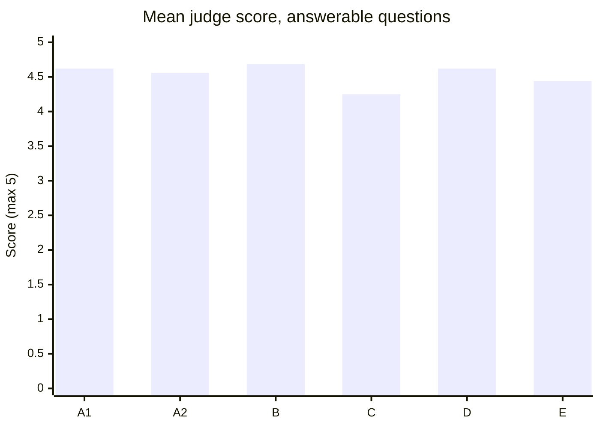
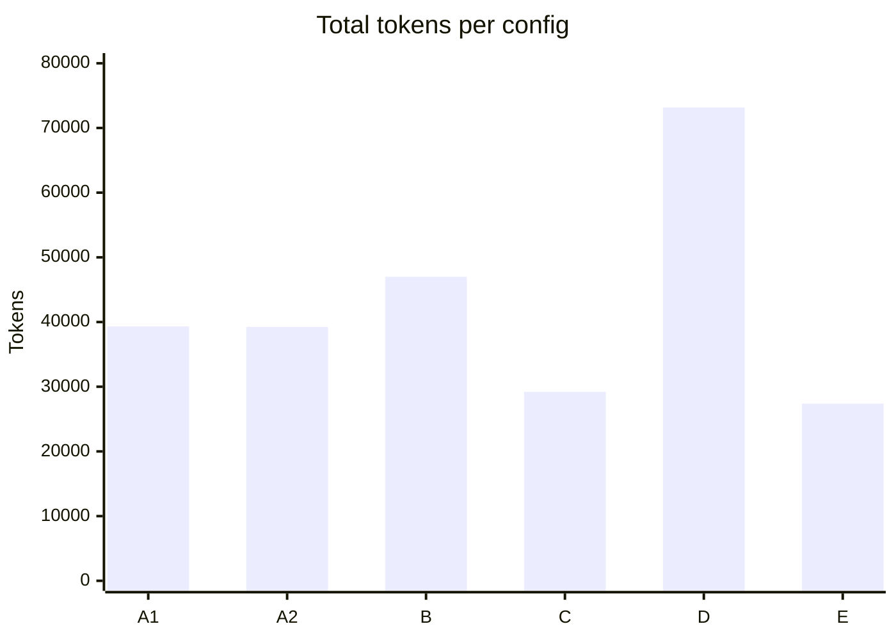
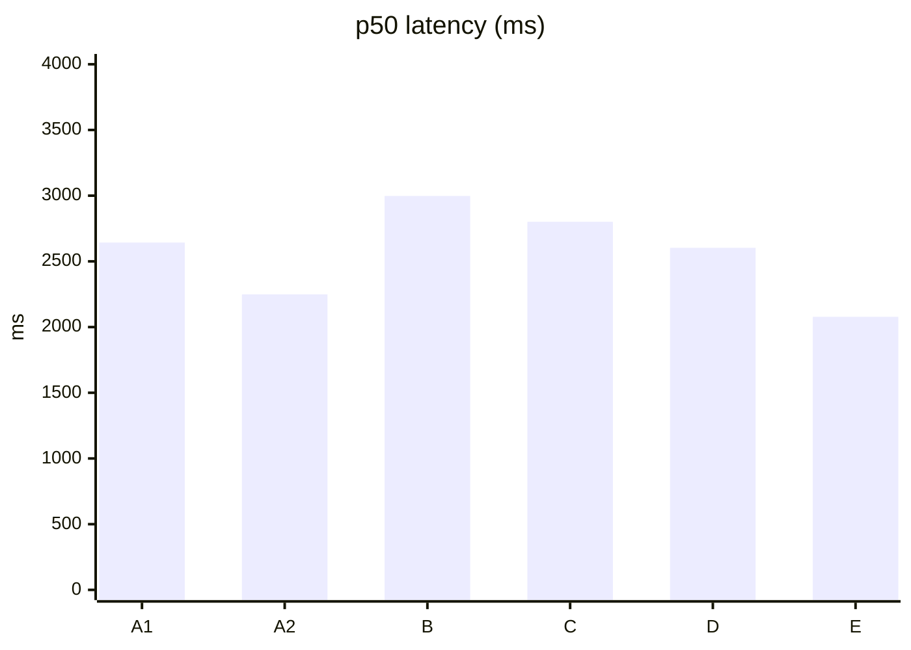
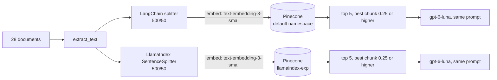

# LlamaIndex vs the current RAG pipeline

**Status:** run complete. We wrote the expected results before the first paid
call; the Results section reports what happened.

This is an experiment, not a migration. The LlamaIndex code lives in
`backend/app/experiments/llamaindex_rag/`. No router imports it, the
production image does not install it, and its vectors sit in a separate
Pinecone namespace.

## Summary

We ran LlamaIndex next to the current mentor chatbot on the same 28 documents
and the same 20 questions.

- **Quality: no detectable difference.** The LlamaIndex judge average is 4.69
  and the current pipeline's is 4.62. Running the current pipeline twice
  gives 4.62 and 4.56, so the gap is inside the noise.
- **A vs B is mostly a splitter comparison.** Both splitters chunk the 19
  short lessons identically, but every question's top 5 includes at least 2
  chunks from the 9 long documents, which chunk differently. We did not
  compare the retrieved chunk texts, so we cannot say on how many questions A
  and B retrieved different chunks.
- **Token use tracks chunk size and top_k.** B uses 19.5% more total tokens
  than A (47,001 vs 39,318, both from the API). That is consistent with B's
  fuller chunks, about 420 tokens on average against 358 for A, with k = 5 in
  both. The experiment did not isolate the cause. The like-for-like
  comparisons all run on LlamaIndex: against B, a lower top_k (C) cuts total
  tokens by 38% and smaller chunks (E) by 42%. Each lost one question: q12 for
  C, q05 for E.
- **The 0.25 similarity cutoff never fired.** Every question without an answer
  scored above it. The system prompt produced all the "not covered" replies.
- **We would not migrate on this evidence.**

Mean judge score on the 16 answerable questions (maximum 5). A1 and A2 are the
same pipeline run twice:

Total tokens for the 20 answers:

Median latency in milliseconds. A1 and A2 differ by about 400 ms, which is
the noise level:

| Config | Setup |
|---|---|
| A1, A2 | current pipeline, 500/50 chunks, top_k = 5 |
| B | LlamaIndex, 500/50, top_k = 5 |
| C | LlamaIndex, 500/50, top_k = 3 |
| D | LlamaIndex, 500/50, top_k = 8 |
| E | LlamaIndex, 256/25, top_k = 5 |

## What we compared

**The current pipeline is not a LangChain RAG chain.** LangChain does one
job: `RecursiveCharacterTextSplitter` cuts documents into chunks of up to 500
tokens with a 50-token overlap. The OpenAI SDK and our own code do everything
else:

- Embeddings: `text-embedding-3-small`.
- Vectors: the Pinecone dev index, default namespace, 482 vectors.
- Retrieval: the top 5 chunks. If the best chunk scores below 0.25 cosine
  similarity, the bot returns a canned "not covered" answer and makes no LLM
  call. Otherwise all 5 chunks go into the prompt.
- Answer: `gpt-6-luna` with `reasoning_effort = "none"`, a system prompt that
  forbids outside knowledge, and excerpts labelled `[Source 1]`, `[Source 2]`.

Someone chose k = 5 and the 0.25 cutoff by hand before any evaluation
existed. The code calls the cutoff "deliberately permissive". Nobody had
measured either value until now.

**The LlamaIndex side uses `llama-index-core` components with our own OpenAI
and Pinecone adapters,** and keeps everything else equal:

| | Current | LlamaIndex |
|---|---|---|
| Documents | 28 active, ready versions | the same 28, from R2 |
| Text extraction | `worker/processing.extract_text` | the same function |
| Chunking | LangChain recursive splitter, 500/50 | LlamaIndex `SentenceSplitter`, 500/50 |
| Tokenizer for chunk size | `cl100k_base` | `cl100k_base` |
| Embedding model | `text-embedding-3-small` | the same |
| Vector store | Pinecone dev index, default namespace | same index, namespace `llamaindex-exp` |
| Retrieval rule | top 5, best chunk ≥ 0.25 | the same |
| Prompt | `CHAT_SYSTEM_PROMPT` + `[Source i]` excerpts | the same text |
| Model | `gpt-6-luna`, streamed | `gpt-6-luna`, not streamed |

Two gaps remain. First, "500/50" produces different chunks in each splitter
(next section). Second, the current pipeline streams its answer and
LlamaIndex does not. Latency counts the full answer in both, so streaming
should change the total little.

### Chunking differs at equal settings

| | Chunks | Avg tokens per chunk | Tokens embedded |
|---|---|---|---|
| Current, 500/50 | 482 | 358 | 172,345 |
| LlamaIndex, 500/50 | 431 | ~420 | 180,867 |
| LlamaIndex, 256/25 | 819 | ~217 | 177,436 |

`SentenceSplitter` packs whole sentences until it reaches the limit, so its
chunks run fuller. LangChain splits by paragraph first and keeps more short
pieces. For the 19 short lessons both splitters give the same count: 17 fit in
one chunk, and the other two split into 2 and 3 chunks. The counts differ only
on the 9 long documents.

The Claude Code PlayBook PDF repeats some passages: one appears in six
different chunks. Identical chunks can fill several top-k slots for a PlayBook
question.

### Adapters we had to write

`llama-index-llms-openai` requires `openai<3` and
`llama-index-vector-stores-pinecone` requires `pinecone<10`. Production runs
openai 3.35 and pinecone 10, so either package would downgrade them. We
installed only `llama-index-core` and `llama-index-embeddings-openai`, and
wrote two small adapters: a `CustomLLM` and a `BasePydanticVectorStore`.

## Method

**Questions.** 20 questions from our own documents: 7 on long documents, 6 on
short lessons, 3 that need two documents, and 4 with no answer. A text search
of all 28 documents confirmed the 4 no-answer topics are absent. Two of them
(the WCAG contrast ratio and a PDPA fine amount) sit next to covered topics,
so a model using outside knowledge would answer them confidently.

**Configs.**

| Config | Pipeline | Chunks | top_k |
|---|---|---|---|
| A1, A2 | current | 500/50 | 5 |
| B | LlamaIndex | 500/50 | 5 |
| C | LlamaIndex | 500/50 | 3 |
| D | LlamaIndex | 500/50 | 8 |
| E | LlamaIndex | 256/25 | 5 |
| sweep | current, retrieval only | 500/50 | 3, 5, 8 × cutoff 0.15, 0.25, 0.35 |

A1 and A2 run the same configuration twice. Their difference shows the noise
level; read every A vs B gap against it.

`build_index` deletes every vector in `llamaindex-exp` before each build. The
256/25 rebuild for E went from 431 to 819 vectors, not 1,250, so no 500/50
vectors were left behind.

**Metrics.**

- `source_hit`: every expected document appears in the retrieved chunks, and
  the cutoff let them through. Answerable questions only.
- Judge score, 1 to 5: `gpt-6-sol` grades each answer against the expected
  answer and the retrieved source text, and may not use its own knowledge. For
  a no-answer question, 5 means "said it is not covered" and 1 means "invented
  an answer". A canned answer is scored without a judge call: 5 on a
  no-answer question, 1 on an answerable one.
- Latency: wall-clock time from question to full answer, retrieval included.
- Tokens and cost: LlamaIndex reports exact prompt and completion tokens. The
  current pipeline reports only the total, so we estimate its split with
  tiktoken (`o200k_base`).
- Sweep: `source_hit` on the 16 answerable questions and the false-accept
  rate on the 4 no-answer ones. A false accept means the best chunk cleared
  the cutoff, so the bot would call the LLM instead of saying "not covered".

**Limits.** 20 questions, one run per config, one judge model. With 4
no-answer questions, one question moves the false-accept rate by 25 points.
The current pipeline's token split is an estimate.

## Expected results (written before the run)

**Noise, A1 vs A2.** Retrieval is deterministic, so `source_hit` should match
exactly. Answers vary between runs, so we expect judge scores to change by
±1 on two to four questions.

**B vs A.** On the 9 questions about short lessons (q08–q16), both pipelines
see nearly the same chunks, so we expect the same hits and judge scores
within noise. On the 7 long-document questions, LlamaIndex's fuller chunks
may carry the answer together with more of its context. We expect at most one
question's hit to change either way. LlamaIndex sends about 17% more context
tokens per answer (5 × ~420 vs 5 × 358), so we expect a slightly higher cost
per answer. We expect latency within noise, since OpenAI response time
dominates both.

**C, top_k = 3.** About 40% fewer context tokens, so lower cost and slightly
lower latency. The two-document questions need both documents in three slots,
and PlayBook duplicates can take slots, so we expect one to three fewer hits,
mostly on q14–q16.

**D, top_k = 8.** We expect the same hits or one more, and about 60% more
context tokens than B. Extra, less relevant chunks may lower some judge
scores. The cutoff looks only at the best chunk, so k cannot change whether a
no-answer question gets the canned answer. More loosely related context may
still tempt the model to answer.

**E, 256/25.** Smaller chunks match a short question more tightly, so we
expect higher similarity scores and better hits on single-fact questions such
as q03, q06 and q11. Answers that list several items (q01, q07, q14) may be
split across chunks, and the top 5 may miss part of the list, so we expect
lower judge scores there. Higher scores also let a no-answer question clear
the 0.25 cutoff more easily, so we expect more false accepts. Context per
answer drops to about half of B's.

**Sweep.** We expect false accepts to rise as the cutoff falls, with most or
all 4 no-answer questions accepted at 0.15, and some answerable questions
gated out at 0.35. We do not know where 0.25 falls between those; the sweep
measures it.

## Results

Every number comes from one run of 20 questions per config. The raw
per-question records are in `backend/app/experiments/llamaindex_rag/results/`.

| Config | Setup | source_hit | Judge, answerable (16) | Judge, unanswerable (4) | p50 / p95 latency | Total tokens | Answer cost |
|---|---|---|---|---|---|---|---|
| A1 | current, k = 5 | 16/16 | 4.62 | 5.00 | 2643 / 4187 ms | 39,318 | $0.0043 |
| A2 | current, k = 5 | 16/16 | 4.56 | 5.00 | 2249 / 3305 ms | 39,251 | $0.0043 |
| B | LlamaIndex 500/50, k = 5 | 16/16 | 4.69 | 5.00 | 2998 / 4847 ms | 47,001 | $0.0051 |
| C | LlamaIndex 500/50, k = 3 | 15/16 | 4.25 | 5.00 | 2801 / 3667 ms | 29,202 | $0.0032 |
| D | LlamaIndex 500/50, k = 8 | 16/16 | 4.62 | 5.00 | 2603 / 3627 ms | 73,174 | $0.0076 |
| E | LlamaIndex 256/25, k = 5 | 16/16 | 4.44 | 5.00 | 2078 / 2757 ms | 27,393 | $0.0030 |

Answer cost covers the 20 answers only. The A rows use an estimated
prompt/completion split, because the API gave only the total. Judging cost
about $0.60 of the $0.63 spent on answers and judging.

Judge score per question. Bold marks a score of 3 or less. The four
unanswerable questions (q17 to q20) scored 5 in every config.

| id | A1 | A2 | B | C | D | E |
|---|---|---|---|---|---|---|
| q01 | 5 | 5 | 5 | 5 | 5 | 5 |
| q02 | 4 | 4 | 5 | 4 | 4 | 4 |
| q03 | 5 | 5 | 5 | 5 | 5 | 5 |
| q04 | **1** | **1** | 4 | **1** | 4 | 4 |
| q05 | 5 | 5 | **3** | 4 | **3** | **1** |
| q06 | 5 | 5 | 5 | 5 | 5 | 5 |
| q07 | 5 | 5 | 5 | 5 | 5 | 5 |
| q08 | 5 | 5 | 5 | 5 | 5 | 4 |
| q09 | 4 | 4 | 4 | 4 | 4 | 4 |
| q10 | 5 | 5 | 5 | 5 | 5 | 5 |
| q11 | 5 | 5 | 5 | 5 | 5 | 5 |
| q12 | 5 | 4 | 4 | **1** | 4 | 4 |
| q13 | 5 | 5 | 5 | 5 | 5 | 5 |
| q14 | 5 | 5 | 5 | 5 | 5 | 5 |
| q15 | 5 | 5 | 5 | 4 | 5 | 5 |
| q16 | 5 | 5 | 5 | 5 | 5 | 5 |

### Noise: A1 vs A2

The same configuration, run twice, changed one judge score out of 20 (q12, 5
vs 4). The means differ by 0.06 (4.62 vs 4.56). Retrieval was identical both
times, so the noise comes from answer generation and judging only. It says
nothing about retrieval: A failed q04 in both runs because it retrieved the
same chunks both times, which makes that one result, not two. B's lead over A1
is +0.07, the same size, so **the average shows no difference between the two
pipelines.**

### Retrieval sweep

The sweep covers the current pipeline's retrieval only, with no LLM answers.
Results for k = 3, 5 and 8 were identical, and that is mostly by design. The
cutoff looks only at the best chunk, which k cannot change, so false accepts
cannot depend on k. Only `source_hit` could, and it stayed at 16/16 because it
checks documents, not chunks.

| Cutoff | source_hit (16 answerable) | False accepts (4 unanswerable) |
|---|---|---|
| 0.15 | 16/16 | 4/4 |
| 0.25 (current) | 16/16 | 4/4 |
| 0.35 | 16/16 | 3/4 |

The number that matters is each question's best-chunk score, since the
cutoff compares only that score. Sorted from highest to lowest, with the
unanswerable questions in bold:

| Question | Type | Best-chunk score |
|---|---|---|
| q03 | single, long | 0.81 |
| q08 | single, short | 0.68 |
| q15 | two documents | 0.68 |
| q16 | two documents | 0.67 |
| q13 | single, short | 0.64 |
| q04 | single, long | 0.64 |
| q14 | two documents | 0.63 |
| q01 | single, long | 0.62 |
| q07 | single, long | 0.56 |
| q02 | single, long | 0.56 |
| q12 | single, short | 0.54 |
| q06 | single, long | 0.54 |
| q09 | single, short | 0.53 |
| q05 | single, long | 0.52 |
| q10 | single, short | 0.52 |
| **q18** | **unanswerable** | **0.49** |
| **q19** | **unanswerable** | **0.44** |
| **q17** | **unanswerable** | **0.42** |
| q11 | single, short | 0.37 |
| **q20** | **unanswerable** | **0.34** |

No cutoff separates the two groups: q11, an answerable question, scores 0.37,
between q20 (0.34) and q17 (0.42). At 0.35, q20 falls below the cutoff and no
answerable question does, which gives the 3/4 false accepts in the table above.
A cutoff near 0.50 would turn away all four unanswerable questions and q11.

The 0.25 cutoff never fired in any of the 120 answered questions, because
every unanswerable question scored above it. The model still replied "not
covered" every time (judge score 5), so the system prompt did that work and
the cutoff did not. The sample is 20 questions and one run: it shows what
happened here and does not justify a new cutoff.

### Where LlamaIndex was worse

- **q05, the "Confused Deputy" question.** A scored 5 in both runs. B and D
  scored 3, and E scored 1. B and D defined the term but left out its link to
  identity and access management. E refused with "not covered", because none
  of its five chunks held the definition. The current pipeline's top five
  included the right chunk of the security paper. Different chunk boundaries
  probably explain it, but we did not check.
- **q12 at k = 3 (config C).** Score 1 and a source miss. All three chunks
  came from the Claude Code PlayBook, which repeats some passages, so the
  Steering Long Sessions lesson was missed. The current pipeline found the
  lesson at k = 3 in the sweep. LlamaIndex found it at k = 5 (B) and in E.
- **E scored 4 on q08** where A scored 5. The judge marked an omission (the
  legal-standards reference) from the expected answer.

### Where LlamaIndex was better

- **q04.** A scored 1 in both runs. Its five chunks all came from the right
  document, but none held the 85% figure, so it answered "not covered". B, D
  and E retrieved a chunk with the figure and scored 4.
- **q02.** B scored 5 against A's 4.

The differences cut both ways: B gained 3 points on q04 and lost 2 on q05,
which is why the averages match.

### Did the expectations hold?

| Expectation | Result |
|---|---|
| A1 vs A2: identical hits, 2 to 4 judge changes | Held for hits. Only 1 judge change, fewer than we guessed. |
| B vs A on the short lessons: same within noise | Held. Only q12 moved, and A2 moved by the same amount. |
| B vs A on long documents: at most one hit changes | Held for hits (none changed). Not for scores: q04 +3, q05 −2. |
| B: about 17% more context tokens, a little more cost | Held. B uses 19.5% more total tokens (47,001 vs 39,318, both from the API), consistent with its fuller chunks. The cost gap, $0.0051 vs $0.0043, uses A's estimated split. |
| B: latency within noise | Unclear. B's p50 is 0.35 to 0.75 s above A's, but D, the same pipeline, matches A. One run cannot settle it. |
| C: about 40% fewer context tokens, lower cost | Held. 38% fewer prompt tokens, $0.0032. |
| C: one to three fewer hits, mostly on q14 to q16 | Half held. It lost one hit, on q12, and q14 to q16 all hit. |
| D: same or one more hit | Held. 16/16 as in B. |
| D: about 60% more context tokens | Held. 57% more than B. |
| D: extra chunks may lower judge scores | Not shown. B 4.69 and D 4.62 is within noise. |
| E: about half of B's context | Mostly held. 42% fewer prompt tokens. |
| E: higher scores on single-fact questions (q03, q06, q11) | Not shown. All three already hit and scored 5. The top score rose on q06 (0.53 to 0.64) and on q01 and q07, but not on q03. |
| E: lower scores on multi-item answers (q01, q07, q14) | Did not hold. All three scored 5. E's drop came from q05 and q08. |
| E: more false accepts | Could not rise. All 4 were already accepted at 0.25 in every config. |
| Sweep: some answerable questions gated out at 0.35 | Did not hold. No answerable question fell below 0.35; one unanswerable question (q20) did. |
| Sweep: most false accepts at 0.15 | Held, but already 4/4 at 0.25. |

## What was easier and harder

**Easier with LlamaIndex**

- Chunking, embedding and indexing took a few lines: `SentenceSplitter` and
  `VectorStoreIndex`.
- Testing was simple. `MockEmbedding` and an in-memory index gave real
  retrieval in tests without a network.

**Harder with LlamaIndex**

- Dependencies. The official OpenAI-LLM and Pinecone packages would have
  downgraded openai and pinecone, so we wrote two adapters (about 100 lines).
- Defaults that change results. LlamaIndex counts metadata against the chunk
  size and embeds it with the text. We had to exclude it to match production,
  which embeds the bare chunk.
- The default query engine would drop the `[Source i]` labels the system
  prompt relies on, so we built the prompt ourselves.
- LlamaIndex's `SimilarityPostprocessor` drops each chunk under the cutoff.
  Production gates on the best chunk only. We reproduced production's rule.
- Our own adapter failed on the first build: all 431 vectors went up in one
  request and exceeded Pinecone's 4 MB limit. That was a bug in our code, not
  in LlamaIndex. Batches of 100 fixed it.

## Conclusion

On these 20 questions we found no evidence that LlamaIndex retrieves or
answers better than the current pipeline, and none that it is worse. The
judge averages differ by 0.07, inside the 0.06 run-to-run noise. The
per-question differences go both ways: B won q04 and lost q05.

The numbers do show three things:

- **Token use is consistent with chunk size.** B uses 19.5% more total tokens
  than A, and its chunks average about 420 tokens against 358, at the same
  k = 5. The experiment did not isolate the cause. On LlamaIndex alone, E
  (256-token chunks) uses 42% fewer total tokens than B and costs $0.0030 per
  20 answers against $0.0051. E also answers fastest (p50 2078 ms), but scored
  4.44 on the judge against B's 4.69, mostly because of q05.
- **Lowering top_k also cuts cost and risks misses.** C (k = 3) used 38% fewer
  total tokens than B and missed one source.
- **The 0.25 cutoff did nothing on this set.** The system prompt handled every
  question without an answer.

We would not migrate on this evidence. The decision should rest on
maintenance cost and fit, which this experiment did not measure.

## Limits

- 20 questions and one run per config. One question moves the answerable
  average by 0.06 to 0.25.
- A vs B is largely a splitter comparison. The short lessons chunk
  identically, but every question's top 5 includes at least 2 chunks from the
  long documents. We did not compare the retrieved chunk texts of A and B, so
  the number of questions with different chunks is unknown.
- A1 vs A2 measures answer and judge noise, not retrieval noise. Retrieval is
  deterministic, so a retrieval miss repeats in every run.
- With four unanswerable questions, one flips the false-accept rate by 25
  points.
- `source_hit` checks the document, not the chunk. It reached 16/16 even for
  A on q04, where the chunk with the answer was never retrieved, so it cannot
  separate the pipelines. A chunk-level check would need an answer phrase per
  question and would be unfair across two chunkers.
- The judge is an LLM that sees the expected answer and marks omissions
  against it. Several 4s mean "answered the question but skipped a detail the
  expected answer lists".
- The judge (`gpt-6-sol`) comes from the same model family as the model it
  grades (`gpt-6-luna`), so it may share that model's blind spots and favor
  its style. A judge from another provider would reduce that risk.
- The current pipeline's prompt/completion split is an estimate. Compare A
  with B on total tokens, which are exact. B vs C, D and E compare like for
  like.
- Latency comes from one run each. A1 and A2 differ by about 0.4 s at p50.
